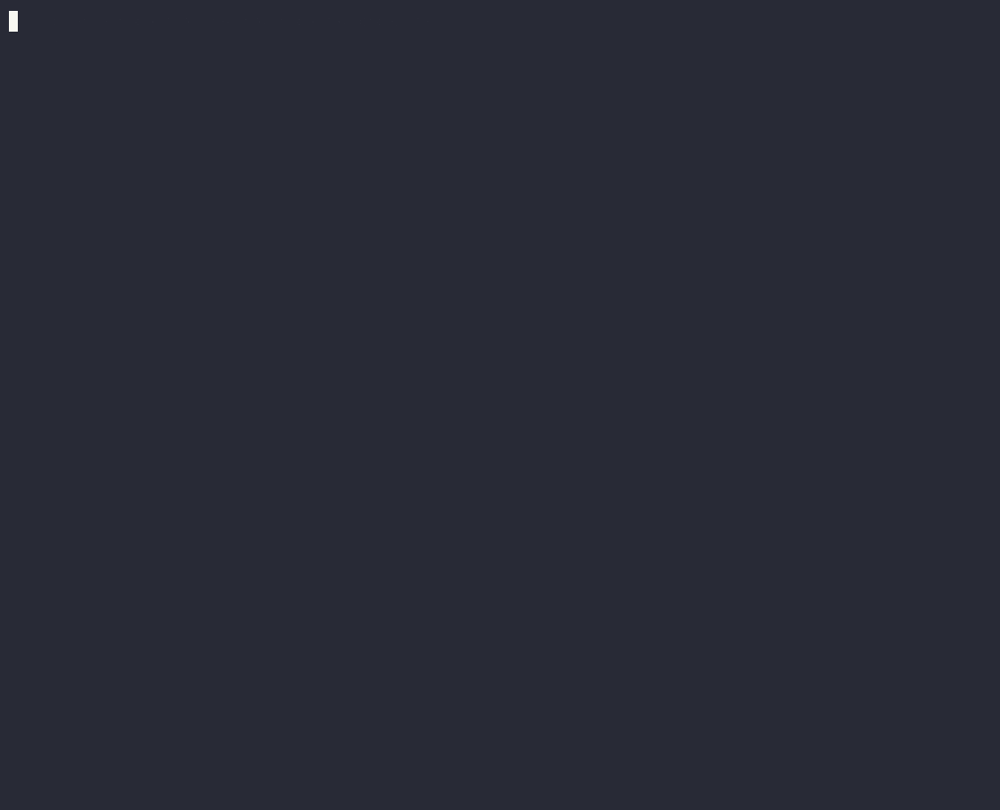

```text
 _               _         _
| |__   __ _ ___| |__   __| | ___   __ _
| '_ \ / _` / __| '_ \ / _` |/ _ \ / _` |
| | | | (_| \__ \ | | | (_| | (_) | (_| |
|_| |_|\__,_|___/_| |_|\__,_|\___/ \__, |
                                    |___/   Merkle-tree file integrity monitor
```

[](https://github.com/DakodaStemen/Hashdog/actions/workflows/ci.yml)
[](https://go.dev)
[](LICENSE)

hashdog watches a directory tree and tells you when a file is **modified, added or removed**. It keeps a SHA-256 Merkle tree of the tree, reacts to filesystem events in real time, and can start from an **ed25519-signed baseline** so a tampered baseline is itself detected.



*Real recording of `docs/demo.sh`: signed baseline → live alerts on modify/add/delete → offline check with JSON → baseline tamper detection → inclusion proof.*

## Features

- **Event-driven** (fsnotify) with debounce; new subdirectories are watched automatically.
- **Periodic full verify** as fallback: re-hashes everything, ignoring the stat cache.
- **Signed baselines** (ed25519): `baseline` / `check` / `watch -baseline`. Edited or wrong-key baselines are rejected (exit 2).
- **Alerts**: text, JSON lines (`-json`), syslog (`-syslog`).
- **Merkle inclusion proofs**: prove a file is under a root with `proof` / `verify-proof`.
- Sample [systemd unit](contrib/hashdog.service).

## Quick start

```bash
go install github.com/DakodaStemen/hashdog@latest   # or: go build -o hashdog .

hashdog keygen   -out hashdog                              # hashdog.key (secret) + hashdog.pub
hashdog baseline -dir /etc -key hashdog.key -out baseline.json
hashdog watch    -dir /etc -baseline baseline.json -pub hashdog.pub -interval 15m
hashdog check    -dir /etc -baseline baseline.json -pub hashdog.pub -json   # one-shot; exit 1 if changed
```

| Command | Purpose | Exit codes |
|---|---|---|
| `keygen` | create ed25519 keypair | 0 |
| `baseline` | write signed snapshot | 0 |
| `check` | one-shot verify against baseline | 0 clean, 1 changes, 2 baseline tampered |
| `watch` | long-running monitor | 2 if baseline tampered |
| `proof` / `verify-proof` | create / verify inclusion proof | 0 valid |

> [!IMPORTANT]
> Keep the **private key off the monitored host** (sign elsewhere, copy only `baseline.json` and `hashdog.pub`). The public key must come from a trusted source, not from the baseline file.

## How it works


Files are leaves (`SHA-256(contents)`); a directory's hash is `SHA-256(child hashes in path order)`. Any change bubbles up to the root, and the diff prunes every subtree whose hash matches.

## Signed baselines

The signature covers the creation time, root hash and the full tree. `Load` checks the signature, then recomputes every directory hash from its children, so a hand-edited tree cannot smuggle in a false root. Tests cover: flipped leaf hash, edited timestamp, truncated file, corrupted signature, wrong key.

## Alerts

JSON (one object per line):

```json
{"time":"2026-10-28T21:06:25Z","kind":"MODIFIED","path":"site/etc/passwd","old_hash":"e787…","new_hash":"532a…","source":"event"}
```

`source` is `event` (fsnotify), `periodic` (full verify) or `baseline` (diff against the signed baseline at startup). Syslog uses tag `hashdog`, facility `auth`, severity `warning`.

> [!NOTE]
> Alerts are edge-triggered: after reporting, the new state becomes the snapshot. Pipe alerts somewhere durable.

## Merkle inclusion proof

```bash
hashdog proof -dir site -file etc/passwd -out p.json
hashdog verify-proof -proof p.json -root <trusted-root> -content site/etc/passwd
```

Directories are n-ary, so each proof level carries all sibling hashes at that level (not one, as in a binary tree). Proof size is the sum of fan-out along the path.

## Benchmark

Corpus: 8,000 random files (4–128 KiB), 532 MB, warm page cache; AMD Ryzen 7 5800H (16 threads); Go 1.27; 15 runs, median (min). Reproduce with `bench/bench.sh DIR`. Raw output: [`bench/results.txt`](bench/results.txt).

| Method | Median | Min |
|---|---|---|
| `find \| xargs sha256sum` (uutils, single process) | 1623 ms | 1235 ms |
| `find \| xargs -P16 sha256sum` | 502 ms | 304 ms |
| `hashdog baseline` (full build + sign + write JSON) | 945 ms | 647 ms |
| `merkle.Build`, full (Go benchmark, 5×) | 970 ms | — |
| `merkle.BuildWith` stat-cached rescan (event path, 5×) | 226 ms | — |

> [!WARNING]
> The machine was under heavy load (load average ≈ 36 on 16 threads) during these runs, so absolute numbers are noisy (max values hit 3–5 s) and the cached-rescan figure varied 19–226 ms across runs. Treat them as order-of-magnitude. A full hashdog scan is faster than a serial `sha256sum` pipeline but **slower than a parallel one**; hashdog's advantage is not raw hashing speed but the stat cache for event scans, the Merkle diff, and signed baselines.

## Limitations

> [!CAUTION]
> - **The stat cache trusts size+mtime** on event-triggered scans. An attacker who restores mtime evades them until the next periodic full verify (a test documents this). Keep `-interval` reasonable.
> - Directory hashes cover child *hashes* only, not names/permissions/ownership: a rename that keeps sort order, or a `chmod`/`chown`, can go undetected.
> - Symlinks, sockets, devices and FIFOs are skipped.
> - A root-privileged attacker can kill the daemon; run it from systemd and ship alerts off-host.

## Development

```bash
go vet ./... && go test -race ./...
```

Layout: `main.go` (CLI) · `internal/merkle` (tree, diff, proofs, snapshots) · `internal/baseline` (signing) · `internal/scanner` (event/periodic loop, sinks) · `bench/` · `contrib/` · `docs/`.

## License

MIT — see [LICENSE](LICENSE).
