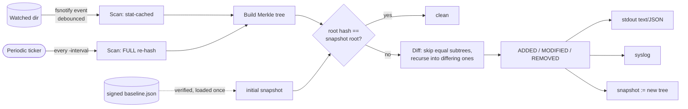

```text
 _               _         _
| |__   __ _ ___| |__   __| | ___   __ _
| '_ \ / _` / __| '_ \ / _` |/ _ \ / _` |
| | | | (_| \__ \ | | | (_| | (_) | (_| |
|_| |_|\__,_|___/_| |_|\__,_|\___/ \__, |
                                    |___/   Merkle-tree file integrity monitor
```

[](https://github.com/DakodaStemen/Hashdog/actions/workflows/ci.yml)
[](https://go.dev)
[](LICENSE)

hashdog watches a directory tree and tells you when a file is **modified, added or removed**. It keeps a SHA-256 Merkle tree of the tree, reacts to filesystem events in real time, and can start from an **ed25519-signed baseline** so a tampered baseline is itself detected.

`docs/demo.sh` runs the same flow end to end: signed baseline → live alerts on modify/add/delete → offline check with JSON → baseline tamper detection → inclusion proof.

## Features

- **Event-driven** (fsnotify) with debounce; new subdirectories are watched automatically.
- **Periodic full verify** as fallback: re-hashes everything, ignoring the stat cache.
- **Signed baselines** (ed25519): `baseline` / `check` / `watch -baseline`. Edited or wrong-key baselines are rejected (exit 2).
- **Alerts**: text, JSON lines (`-json`), syslog (`-syslog`).
- **Metadata-aware (baseline v2)**: mode, uid, gid and symlink targets are hashed into each leaf, so `chmod`/`chown`/symlink retargeting are detected, not just content edits.
- **Include/exclude rules** (`-include`, `-exclude`, `-config`), signed into the baseline.
- **Triage hints**: alerts on well-known persistence/credential paths carry MITRE ATT&CK technique IDs (a hint, not a verdict).
- **Merkle inclusion proofs**: prove a file is under a root with `proof` / `verify-proof`.
- Sample [systemd unit](contrib/hashdog.service).

## Quick start

```bash
go install github.com/DakodaStemen/hashdog@latest   # or: go build -o hashdog .

hashdog keygen   -out hashdog                              # hashdog.key (secret) + hashdog.pub
hashdog baseline -dir /etc -key hashdog.key -out baseline.json
hashdog watch    -dir /etc -baseline baseline.json -pub hashdog.pub -interval 15m
hashdog check    -dir /etc -baseline baseline.json -pub hashdog.pub -json   # one-shot; exit 1 if changed
```

| Command | Purpose | Exit codes |
|---|---|---|
| `keygen` | create ed25519 keypair | 0 |
| `baseline` | write signed snapshot | 0 |
| `check` | one-shot verify against baseline | 0 clean, 1 changes, 2 baseline tampered, 4 legacy/unsupported baseline format |
| `watch` | long-running monitor | 2 if baseline tampered, 4 legacy/unsupported baseline format |
| `version` | print version, commit, build date, baseline format | 0 |
| `proof` / `verify-proof` | create / verify inclusion proof | 0 valid |

> [!IMPORTANT]
> Keep the **private key off the monitored host** (sign elsewhere, copy only `baseline.json` and `hashdog.pub`). The public key must come from a trusted source, not from the baseline file.

## Flags

Shared by `baseline`, `check` and `watch`:

| Flag | Meaning |
|---|---|
| `-exclude GLOB` | leave matching files/directories out of the tree (repeatable). Excluded directories are not descended into. |
| `-include GLOB` | allow-list for files (repeatable). If any is given, only matching files are monitored. Exclude wins over include. |
| `-config FILE` | YAML or JSON file with `include:` / `exclude:` lists (unknown keys are an error). Merged with the flags. |

`watch` only:

| Flag | Meaning |
|---|---|
| `-paranoid` | never use the stat cache; every scan, including event-triggered ones, re-reads and re-hashes every file. Closes the mtime-forgery gap (see Limitations) at the cost of CPU/IO. |

Glob syntax is a small gitignore-like subset: `*.log` (no `/`) matches a base name at any depth; a pattern containing `/` is anchored at the watched root; `**` as a whole segment matches zero or more directories; a trailing `/` restricts to directories.

```bash
hashdog baseline -dir /etc -key hashdog.key -out baseline.json -exclude '*.cache' -exclude 'ld.so.cache'
hashdog check    -dir /etc -baseline baseline.json -pub hashdog.pub     # uses the signed rules
```

The rules are **signed into the baseline**. `check`/`watch` scan with exactly those rules; passing different rules at verify time is refused (otherwise an unsigned config file could widen the exclusions and hide changes, or cause phantom ADDED/REMOVED alerts).

## Threat model

**Goal:** detect unauthorized changes to files under a watched directory, and detect tampering with the baseline used to judge them.

**In scope**
- An attacker who modifies, adds, removes or `chmod`/`chown`s files, or retargets symlinks, under the watched tree (detected on the next event or periodic scan).
- An attacker who edits the stored baseline, or swaps in one signed with another key (rejected: ed25519 signature + recomputed directory hashes).
- An attacker who edits an unsigned config to hide paths (rules are signed; mismatches are refused).

**Out of scope / not defended**
- An attacker with root on the monitored host can kill or patch the daemon, replace the binary, or tamper with the alert stream. Run from systemd and ship alerts off-host; hashdog has no tamper-evident alert log yet.
- Compromise of the signing key or a public key obtained from an untrusted place.
- Changes between a bad initial state and baseline creation: the baseline is only as trustworthy as the state it was taken from.
- Kernel/rootkit-level hiding of files from `readdir`/`read`.
- Event-triggered scans trust the stat cache (size, mtime, ctime, inode, device). ctime cannot be set from userspace without changing the clock, but a root attacker can still defeat it; use `-paranoid` or rely on the periodic full verify.
- Extended attributes, ACLs, SELinux labels, and file-timestamp-only changes are not hashed.

## How it works



In a v2 tree a file leaf is a hash over a domain separator, the SHA-256 of the contents, mode, uid, gid and (for symlinks) the link target. A directory's hash is `SHA-256(child hashes in path order)`. Any change bubbles up to the root, and the diff prunes every subtree whose hash matches.

## Signed baselines

### Format v2 and older baselines

Baseline **v2** (current) hashes mode/uid/gid/symlink target into each leaf, records symlinks as leaves, stores the hash inputs per leaf (so alerts can say *which* fields changed), and includes the include/exclude rules in the signed payload.

A **v1** baseline (content-only leaf hashes) is **not** silently upgraded. Its hashes cannot be compared with v2 scans (every leaf would differ), and "upgrading" it from the current disk contents would mean trusting whatever is on disk now. `check`/`watch` instead print an error and exit **4**; a baseline from a newer hashdog also exits 4. To migrate, re-create the baseline from a state you trust:

```bash
hashdog baseline -dir /etc -key hashdog.key -out baseline.json
```

A baseline that fails signature or hash checks exits 2 (tampered), which is distinct from the legacy case (4).

### Integrity checks

The signature covers the creation time, root hash and the full tree. `Load` checks the signature, then recomputes every directory hash from its children, so a hand-edited tree cannot smuggle in a false root. Tests cover: flipped leaf hash, edited timestamp, truncated file, corrupted signature, wrong key.

## Comparison

Qualitative, based on each project's documented design; hashdog is a small single-purpose tool and is **not** a replacement for these.

| | hashdog | AIDE | Samhain | Wazuh (syscheck/FIM) |
|---|---|---|---|---|
| Scope | FIM only | FIM only | Host IDS, FIM is core | Full XDR/SIEM platform; FIM is one module |
| Deployment | Single static binary | Single binary + DB | Standalone or client/server | Agent + manager + indexer/dashboard |
| Real-time detection | Yes (fsnotify) + periodic | Typically scheduled runs (cron/timer) | Yes (daemon, scheduled checks; inotify-based realtime in recent versions) | Yes (realtime mode on Linux/Windows) + scheduled |
| Signed baseline built in | Yes (ed25519) | Left to the operator (e.g. protect DB offline) | Yes (signed DB/config) | Central manager holds state |
| Tamper-evident alert log | **No** | No | Yes (signed, hash-chained logs) | Via central server |
| Compared attributes | content, mode, uid, gid, symlink target | Large set (perms, owner, times, xattrs/ACL, selinux, multiple hashes) | Large set | Content, perms, owner, attributes; Windows registry |
| Merkle tree / inclusion proofs | Yes | No | No | No |
| Correlation, response, central mgmt | No | No | Limited (central log server) | Yes |
| Maturity | New, small test suite, no external audit | Long-established | Long-established | Large production ecosystem |

Where hashdog fits: a minimal, auditable monitor with a signed baseline and a cheap tree diff. If you need xattr/ACL coverage, fleet management, or tamper-evident remote logging today, use one of the others.

## Alerts

JSON (one object per line):

```json
{"time":"2026-10-28T21:06:25Z","kind":"MODIFIED","path":"site/etc/passwd","old_hash":"e787…","new_hash":"532a…","source":"event"}
```

`source` is `event` (fsnotify), `periodic` (full verify) or `baseline` (diff against the signed baseline at startup). Syslog uses tag `hashdog`, facility `auth`, severity `warning`.

> [!NOTE]
> Alerts are edge-triggered: after reporting, the new state becomes the snapshot. Pipe alerts somewhere durable.

## Merkle inclusion proof

```bash
hashdog proof -dir site -file etc/passwd -out p.json
hashdog verify-proof -proof p.json -root <trusted-root> -content site/etc/passwd
```

Directories are n-ary, so each proof level carries all sibling hashes at that level (not one, as in a binary tree). Proof size is the sum of fan-out along the path.

## Benchmark

Corpus: 8,000 random files (4–128 KiB), 532 MB, warm page cache; AMD Ryzen 7 5800H (16 threads); Go 1.27; 15 runs, median (min). Reproduce with `bench/bench.sh DIR`. Raw output: [`bench/results.txt`](bench/results.txt).

| Method | Median | Min |
|---|---|---|
| `find \| xargs sha256sum` (uutils, single process) | 1623 ms | 1235 ms |
| `find \| xargs -P16 sha256sum` | 502 ms | 304 ms |
| `hashdog baseline` (full build + sign + write JSON) | 945 ms | 647 ms |
| `merkle.Build`, full (Go benchmark, 5×) | 970 ms | — |
| `merkle.BuildWith` stat-cached rescan (event path, 5×) | 226 ms | — |

> [!WARNING]
> The machine was under heavy load (load average ≈ 36 on 16 threads) during these runs, so absolute numbers are noisy (max values hit 3–5 s) and the cached-rescan figure varied 19–226 ms across runs. Treat them as order-of-magnitude. A full hashdog scan is faster than a serial `sha256sum` pipeline but **slower than a parallel one**; hashdog's advantage is not raw hashing speed but the stat cache for event scans, the Merkle diff, and signed baselines.

## Limitations

> [!CAUTION]
> - **The stat cache trusts size, mtime, ctime, inode and device** on event-triggered scans (best-effort; a platform without ctime never gets cache hits). A root attacker who can defeat it evades event scans until the next periodic full verify. Use `-paranoid` to disable the cache.
> - Directory hashes cover child *hashes* only, not names: a pure rename of a file that keeps its sort position among siblings leaves the directory hash unchanged and may go undetected. (Mode/uid/gid/symlink target are covered by v2 leaves.)
> - Extended attributes, ACLs and timestamps are not hashed.
> - Sockets, devices and FIFOs are skipped.
> - A root-privileged attacker can kill the daemon; run it from systemd and ship alerts off-host.

## Releases

Tagging `vX.Y.Z` triggers `.github/workflows/release.yml`, which runs the tests and then GoReleaser (`.goreleaser.yaml`): linux/darwin × amd64/arm64 archives, `.deb`/`.rpm` packages, `checksums.txt`, and a keyless [cosign](https://github.com/sigstore/cosign) signature of the checksum file. Verify a download:

```bash
sha256sum -c checksums.txt --ignore-missing
cosign verify-blob checksums.txt --signature checksums.txt.sig --certificate checksums.txt.pem \
  --certificate-identity-regexp 'https://github.com/DakodaStemen/Hashdog/\.github/workflows/release\.yml@refs/tags/v.*' \
  --certificate-oidc-issuer https://token.actions.githubusercontent.com
```

`hashdog version` prints the embedded version, commit and build date.

## Development

```bash
go vet ./... && go test -race ./...
```

Layout: `main.go` (CLI) · `internal/merkle` (tree, diff, proofs, snapshots) · `internal/baseline` (signing) · `internal/scanner` (event/periodic loop, sinks) · `bench/` · `contrib/` · `docs/`.

## License

MIT — see [LICENSE](LICENSE).
